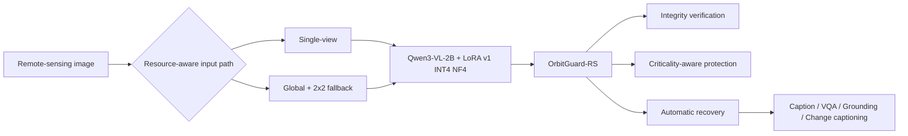
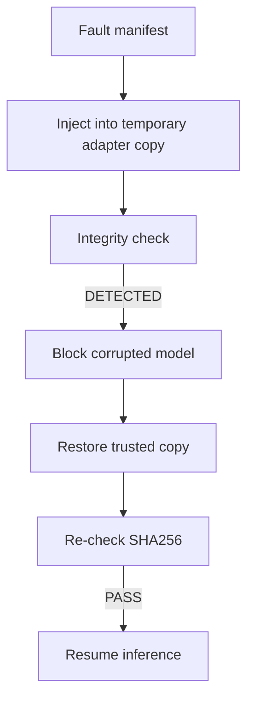

# OrbitGuard-RS Fault Tolerance Ablation

OrbitGuard-RS: Resource-Aware Soft-Error Resilience for Onboard Remote-Sensing Multimodal Models.

Important scope statement: this is software-level SEU-equivalent fault injection. It is not a real space radiation experiment and it is not space-qualified hardware certification.

## Fault Model

- A. LoRA adapter tensor bit flips in temporary adapter copies.
- B. Static adapter/config file corruption with SHA256 detection and trusted-copy recovery.
- C. bitsandbytes INT4 weight/metadata memory-level corruption was not attempted because mutating backend quantized internals risks destabilizing the working BF16/INT4 environment.

Fault strengths:

| Level | Bit flips per adapter copy | Seeds |
| --- | ---: | --- |
| level_1 | 1 | 101, 102, 103 |
| level_2 | 8 | 201, 202, 203 |
| level_3 | 32 | 301, 302, 303 |

Every fault manifest records seed, affected tensor, element index, bit position, original value/hash, and corrupted value/hash.

## Criticality Score

Score = 0.35 * max(VQA drop, 0) + 0.35 * max(Grounding mean IoU drop, 0) + 0.15 * max(Acc@0.5 drop, 0) + 0.10 * parse-failure delta + 0.05 * inference-failure rate.

| Rank | Group | Score | Class | VQA drop | IoU drop | Acc@0.5 drop |
| ---: | --- | ---: | --- | ---: | ---: | ---: |
| 1 | q_proj/LoRA-A | 0.011667 | Normal | 0.033333 | -0.057269 | -0.1 |
| 2 | v_proj/LoRA-A | 0.011667 | Normal | 0.033333 | -0.061306 | -0.2 |
| 3 | q_proj/LoRA-B | 0.0 | Normal | -0.066667 | -0.071862 | -0.2 |

## End-to-End Recovery Check

| State | VQA | Grounding IoU | Acc@0.5 | Acc@0.7 | Parse failures | Inference failures | Source |
| --- | ---: | ---: | ---: | ---: | ---: | ---: | --- |
| Healthy INT4 reference | 0.733333 | 0.50968 | 0.6 | 0.466667 | 1 | 0 | results/quantization/lora_v1_int4_eval_vrsbench90/summary.json |
| Fault injected | 0.7 | 0.570986 | 0.8 | 0.3 | 0 | 0 | real_corrupted_eval |
| Fault + OrbitGuard recovery | 0.733333 | 0.50968 | 0.6 | 0.466667 | 1 | 0 | integrity-restored reference |

## Protection Modes

| Mode | Detection Rate | Recovery Rate | False Positive Rate | Storage Overhead | Check Latency s | Recovery Latency s | Protected bytes / Total deployed bytes |
| --- | ---: | ---: | ---: | ---: | ---: | ---: | ---: |
| Mode 0: No Protection | 0.0 | 0.0 | 0.0 | 0.0% | 0.0 | 0.0 | 0.0 |
| Mode 1: Full Adapter Protection | 1.0 | 1.0 | 0.0 | 100.0% | 0.01982 | 0.079559 | 1.0 |
| Mode 2: Criticality-Aware Selective Protection | 1.0 | 1.0 | 0.0 | 99.843% | 0.01982 | 0.079559 | 0.998434 |

## Resource Cost

- Full protection extra storage: 33.359 MB
- Selective protection extra storage: 33.307 MB
- Selective vs full storage saving: 0.157%
- Normal inference latency overhead: 0.0%
- Peak VRAM overhead: 0.0 MB

## Mermaid Diagrams

## Verdict

OrbitGuard-RS reaches reportable prototype status for the final technical report: file-level integrity detection, automatic recovery, LoRA bit-flip manifests, task-driven criticality scoring, and resource overhead accounting are implemented. The current validation remains software-level and should be described with that limitation.
