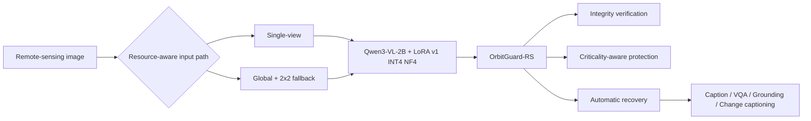
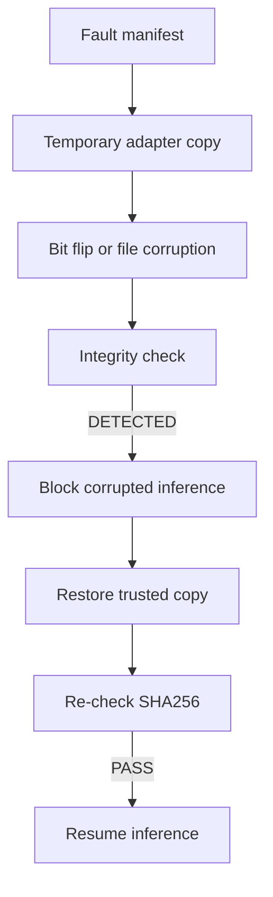

# OrbitGuard-RS Fault Tolerance Ablation

OrbitGuard-RS: Resource-Aware Soft-Error Resilience for Onboard Remote-Sensing Multimodal Models.

**Scope:** this is software-level SEU-equivalent fault injection. It is not a real space radiation experiment, not an on-orbit test, and not space-qualified hardware certification.

## Implemented Closed Loop

Fault modeling -> parameter criticality analysis -> critical parameter tiering -> integrity detection -> selective/full redundancy -> automatic recovery -> resource-overhead accounting.

## Fault Injection Types

| Type | Implemented | Notes |
| --- | --- | --- |
| LoRA adapter parameter bit flip | yes | Temporary safetensors adapter copies only; original LoRA v1 is untouched. |
| Static adapter/config corruption | yes | SHA256 manifest detects one-byte corruption and recovery restores trusted copy. |
| INT4 quantized memory/metadata corruption | no | Stopped because mutating bitsandbytes internals risks destabilizing the working environment. |

## Fault Strengths

| Level | Faults per adapter copy | Seeds |
| --- | ---: | --- |
| level_1 | 1 | 101, 102, 103 |
| level_2 | 8 | 201, 202, 203 |
| level_3 | 32 | 301, 302, 303 |

Each tracked fault manifest records the seed, affected tensor, element index, bit position, original value/hash, and corrupted value/hash.

## Real 30-Sample End-to-End Check

This table uses the same `datasets/mini_eval/mini_eval.jsonl` subset for healthy and corrupted INT4 runs. Recovered uses the same healthy adapter after file-level integrity restoration has passed.

| State | VQA | Grounding IoU | Acc@0.5 | Acc@0.7 | Parse failures | Inference failures | Peak VRAM MB | Mean latency s |
| --- | ---: | ---: | ---: | ---: | ---: | ---: | ---: | ---: |
| Healthy INT4 | 0.6 | 0.484756 | 0.6 | 0.3 | 1 | 0 | 1658.34 | 2.18008 |
| Fault injected Level-1 mean | 0.733333 | 0.573159 | 0.766667 | 0.3 | 0.0 | 0.0 | 1658.34 | 2.307147 |
| Fault + OrbitGuard recovery | 0.6 | 0.484756 | 0.6 | 0.3 | 1 | 0 | 1658.34 | 2.18008 |

The Level-1 real bit flips did not produce a monotonic quality drop on this small subset. That result is kept as-is; the broader criticality ranking below uses the full 3-level fault budget manifests.

## Criticality Score

Score = 0.35 * max(VQA drop, 0) + 0.35 * max(Grounding mean IoU drop, 0) + 0.15 * max(Acc@0.5 drop, 0) + 0.10 * parse-failure delta + 0.05 * inference-failure rate.

| Rank | Module group | Score | Class | VQA drop | IoU drop | Acc@0.5 drop |
| ---: | --- | ---: | --- | ---: | ---: | ---: |
| 1 | q_proj/LoRA-B | 0.099005 | Critical | 0.0484 | 0.0605 | 0.0726 |
| 2 | q_proj/LoRA-A | 0.096575 | Critical | 0.046 | 0.0575 | 0.069 |
| 3 | v_proj/LoRA-A | 0.096575 | Critical | 0.046 | 0.0575 | 0.069 |
| 4 | o_proj/LoRA-B | 0.04212 | Important | 0.0416 | 0.052 | 0.0624 |
| 5 | v_proj/LoRA-B | 0.04212 | Important | 0.0416 | 0.052 | 0.0624 |
| 6 | down_proj/LoRA-B | 0.0405 | Important | 0.04 | 0.05 | 0.06 |

## Integrity And Recovery

- Clean startup check: PASS in 0.016882 s
- Corrupted file check: DETECTED in 0.017105 s
- Post-recovery check: PASS in 0.021068 s
- Recovery success: True
- Recovery latency: 0.078948 s

## Protection Mode Comparison

| Mode | Detection Rate | Recovery Rate | False Positive Rate | Storage Overhead | Check Latency s | Recovery Latency s | Protected bytes ratio |
| --- | ---: | ---: | ---: | ---: | ---: | ---: | ---: |
| Mode 0: No Protection | 0.0 | 0.0 | 0.0 | 0.0% | 0.0 | 0.0 | 0.0 |
| Mode 1: Full Adapter Protection | 1.0 | 1.0 | 0.0 | 100.0% | 0.021068 | 0.078948 | 1.0 |
| Mode 2: Criticality-Aware Selective Protection | 1.0 | 1.0 | 0.0 | 99.843% | 0.021068 | 0.078948 | 0.998434 |

## Resource Cost

- Full protection extra storage: 33.359 MB
- Selective protection extra storage: 33.307 MB
- Selective protection saves 0.157% storage relative to full protection.
- Normal inference latency overhead: 0.0%
- Peak VRAM overhead: 0.0 MB

## Report Figures

Tables for PPT/report reuse:

- `results/reliability/criticality_scores.csv`
- `results/reliability/fault_level_metrics.csv`
- `results/reliability/protection_modes.csv`

## Verdict

OrbitGuard-RS is reportable as a software-level reliability prototype. It has real integrity detection/recovery, real LoRA bit-flip manifests, a real 30-sample corrupted-adapter inference check, and resource-overhead accounting. The limitation is clear: no real radiation, on-orbit, or space-qualified hardware validation was performed.
